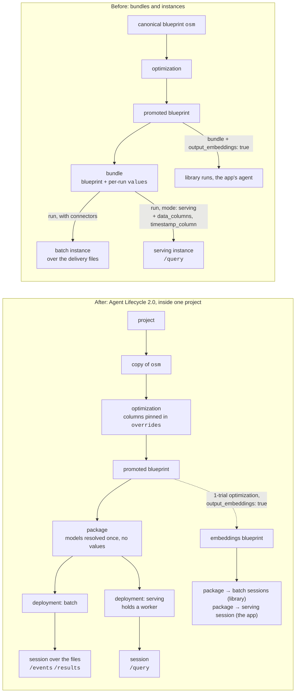
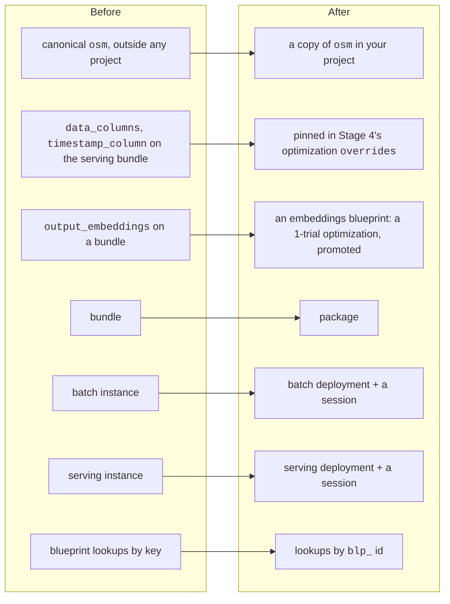

# Migrating to Agent Lifecycle 2.0

How this quickstart moved from bundles and instances to **projects, packages,
deployments and sessions**, and what to watch for if you move your own scripts.
Stages 4–9 were run end to end on 2026-10-30. That run used an org-admin key, but the
scripts make no admin-only call (see 6 below); a run with a member key is still to be
confirmed.

`/api/agents/bundles` and `/api/agents/instances` are being retired: move to the calls
below. To check that your deployment of the platform serves them, `GET
{root}/api/agents/sessions?limit=1` should answer 200, not 404.

## Before and after

- **Project:** where everything lives. Every object takes its project from the one it
  was made from: an optimization from its blueprint, a promoted blueprint from its
  optimization, a package from its blueprint, a deployment from its package, a session
  from its deployment.
- **Package:** one blueprint, target `platform`, with its models resolved when it is
  built (the Omega encoder `mdl_…`, the fitted kNN `aar_…`). It has **no values**.
- **Deployment:** the package placed to run. `batch` is ready at once; `serving` places
  and loads the agent on a worker, usually within seconds, and holds that worker until
  it is stopped.
- **Session:** a run on a deployment. On `batch`, one run over its input files. On
  `serving`, a client's handle on the loaded agent, answering `/query` once it is
  `running` and staying open until it is cancelled or the deployment ends. Several
  sessions can share one serving deployment.

## What moved where

| Before | After | Why it changed |
|---|---|---|
| canonical `osm`, outside any project | a copy of `osm` in your project (`larco-qs`) | a deployment needs a project, and everything takes its project from the blueprint it starts from |
| `data_columns`, `timestamp_column` as serving-bundle values | pinned in Stage 4's `overrides` | a package has no values; the serving source reads them from the blueprint (batch reads the CSV header) |
| `output_embeddings: true` on a bundle | an embeddings blueprint | an output can't be switched on per run any more |
| bundle | package | its models are resolved once, at build time |
| instance (batch) | batch deployment + a session | the deployment is set up once; each run is a session |
| instance (serving) | serving deployment + a session | the deployment holds the loaded agent; sessions are clients of it |
| `GET /blueprints/{key}` | `GET /blueprints/{blp_id}` | a key registered in a project resolves only with `?project_id=` |
| `/logs` | session `status`, `error`, `/events` | a session reaches a terminal status and says why |

## Old calls, new calls

All paths are under `{root}/api/agents` unless shown otherwise.

| Before | After |
|---|---|
| — | `POST {root}/api/projects` `{name, description}` |
| optimize the canonical `osm` | `POST /blueprints/osm/copy` `{project_id, blueprint_key}`, then optimize the copy |
| `POST /bundles` `{blueprint, values}` | `POST /packages` `{blueprint_ids: [blp_…], target: {kind: "platform"}, name}`; poll until `ready` |
| `POST /bundles/{id}/run` `{connectors}` | `POST /deployments` `{package_id, kind: "batch"}`, then `POST /sessions` `{deployment_id, connectors: {source: [...]}}` |
| `POST /bundles/{id}/run` `{mode: "serving"}` | `POST /deployments` `{package_id, kind: "serving"}`; poll until `ready`; `POST /sessions` `{deployment_id}`; poll until `running` |
| `GET /instances/{id}` | `GET /sessions/{id}` (`status`, `error`, `job_id`) |
| `GET /instances/{id}/events`, `/logs` | `GET /sessions/{id}/events` (newest first; there is no `/logs`) |
| `GET /instances/{id}/results` | `GET /sessions/{id}/results` |
| `POST /instances/{id}/query` | `POST /sessions/{id}/query` (same body, same `response`) |
| `POST /instances/{id}/cancel`, `DELETE /instances/{id}` | `POST /sessions/{id}/cancel`, `DELETE /sessions/{id}` |
| `DELETE /bundles/{id}` | `POST /deployments/{id}/stop`, `DELETE /deployments/{id}`, then `DELETE /packages/{id}` |
| `GET /instances?bundle_id=` | `GET /deployments?package_id=`, `GET /sessions?deployment_id=` |

Statuses: package `building → ready | failed`; deployment `deploying → ready → stopping →
stopped | failed`; session `pending → running → completed | failed | cancelled` (and
`paused`).

## What changed in practice

1. **Get into a project by copying `osm`.** A deployment needs its package in a project,
   and a package lands in its blueprint's project. The canonical `osm` is outside any
   project, and `POST /optimizations` takes no `project_id`, so Stage 4 copies `osm` into
   the project first and optimizes the copy (`fit/atai.py`, `base_blueprint()`). An
   existing project of that name, and an existing copy under `larco-qs`, are reused.

2. **Pin at Stage 4 what later stages need.** A bundle could add values per run; a
   package runs the promoted blueprint as stored. Stage 8's serving source reads
   `data_columns` and `timestamp_column` from values (a served query has no CSV header),
   so Stage 4 pins them, next to `states`. `fit/serve.py` refuses a blueprint that
   doesn't pin them.

3. **The step doesn't change here.** The quickstart's trial runs at window 512, step
   512, and the bundle delivered at that same step, so Stages 6 and 8 score exactly the
   windows they did before: every number is unchanged.

4. **Embeddings need their own blueprint.** The library view and the app need each
   window's embeddings, which an agent returns only with `output_embeddings: true`.
   `fit/library_embeddings.py` now makes an embeddings blueprint: a 1-trial optimization
   at Stage 5's trial's point (window, step, k, metric, weights) with the switch pinned,
   then promoted. Its kNN is refitted, but embeddings depend only on the encoder and the
   windowing: the view came out the same to within 1.4×10⁻⁵. The app's bridge serves the
   same blueprint, when it was made from the current Stage 5 blueprint.

5. **Look blueprints up by id.** `GET /blueprints/{key}` resolves a key registered in a
   project only with `?project_id=`; the scripts and the bridge use the `blp_` id.

6. **No admin-only calls.** Two calls that would need the org-admin role are avoided or
   have a fallback:
   - `POST /blueprints` (registering an edited copy of a promoted blueprint, e.g. with
     embeddings on) takes the admin role; the 1-trial optimization doesn't;
   - choosing `blueprint_key` on promote takes it too: `fit/test.py` tries its own key and,
     on a 403, lets the platform choose (`larco-qs-<trial id>`).

7. **A session's result `ref` is a root path.** `/sessions/{id}/results` returns
   `ref: "/api/files/<fil_…>/content"`, which already includes `/api`: resolve it against
   the deployment root (`fit/atai.py`, `result_url`).

8. **Cleanup goes session, deployment, package.** Each holds the next. Cancel a session
   that is still going and stop a deployment that is still up before deleting them.
   `fit/cleanup.py` starts from each recorded package and lists its deployments and their
   sessions, so ones a script never recorded are found too. It keeps the embeddings
   blueprint's id in `fit/out/library_state.json`, for a rerun and for the app.

## This repo, file by file

| File | Change |
|---|---|
| `fit/atai.py` | `base_blueprint()` (the project and its copy of `osm`), `create_package`, `deploy`, `open_session`, `wait_running`, `end`, `result_url` |
| `fit/optimize.py` | optimize the project's copy; `data_columns`, `timestamp_column` (and `states`) pinned |
| `fit/test.py` | an earlier promotion looked up by id |
| `fit/deliver.py` | a package, one batch deployment, a session over the files; results through their ref |
| `fit/serve.py` | a serving deployment and one session; all three deleted on exit |
| `fit/library_embeddings.py` | the embeddings blueprint, then a package, a batch deployment and a session per library file |
| `app-serving/scripts/serving-bridge.js` | the embeddings blueprint, packaged, deployed for serving, a session; a session that stops taking queries is replaced, with a new deployment if the old one is gone |
| `fit/cleanup.py` | sessions, deployments, packages, found from each package |

## Results against the bundle version

| Stage | Measure | Bundles (production, 2026-10-29) | Packages and sessions (2026-10-30) |
|---|---|---|---|
| 4 | validation macro-F1, k 5 / k 31 | 0.8305 / 0.7980 | 0.8305 / 0.7980 |
| 5 | test macro-F1 | 0.8617 | 0.8617, the same confusion matrix |
| 6 | delivery | 3,178 windows | 3,178 windows, one session, 140 s |
| 7 | delivery macro-F1 | 0.7707 | 0.7707, per cycle too |
| 8 | served against batch | 3,178/3,178 states, 448 ms median | 3,178/3,178 states (the same 2 windows a vote off), 512 ms median |
| 9 | library view | 800 windows, 86% nearest their own state | the same, to within 1.4×10⁻⁵ |

## Moving your own scripts

1. Create a project, or reuse yours, and copy the blueprint you start from into it.
2. Move every per-run `values` override into the optimization's `overrides` (columns a
   serving source needs, outputs), or into a separate promoted blueprint if only some
   runs need it.
3. Replace `bundles` with a package (poll until `ready`), and each run with a session on
   a `batch` or `serving` deployment.
4. Look blueprints in a project up by `blp_` id, or pass `?project_id=` with a key.
5. Read `/sessions/{id}/events` and `/results`, and resolve result refs against the root,
   not against `…/api`.
6. Clean up sessions, then deployments, then packages; stop serving deployments when
   you're done, since each holds a worker.
